<div align="center">


<h1>Hi, I'm Kevin </h1>

<a href="https://github.com/kevmpr">
  
</a>

<p>
  <a href="https://www.linkedin.com/in/kevin-m-palma-r/"></a>
  <a href="https://kevin-m-palma-r.vercel.app/en"></a>
  <a href="mailto:kev.mpr03@outlook.com"></a>
  
</p>

</div>

<table>
<tr>
<td valign="top">

###  About me

I'm an **Azure Cloud & AI Solution Architect SSR** on the CoE Cloud team at **Movistar Argentina** (Telefónica Móviles Argentina). I design, migrate and govern Azure environments for B2B customers: landing zones, migrations (on-premises and Azure to Azure), disaster recovery, cost governance and security reviews, plus multi-agent AI systems built with Copilot Studio and Microsoft Foundry.

Alongside my full-time role, I'm studying Computer Engineering at **UADE** and doing freelance web development. I'm passionate about solving real infrastructure problems, learning from teammates and pushing myself into new territory.

```yaml
kevin:
  role: Azure Cloud & AI Solution Architect @ Movistar Argentina
  based_in: Buenos Aires, Argentina
  focus: [landing zones, migrations, governance, AI agents, MCP]
  learning: [AB-100, SC-500, SC-100, Terraform, AWS]
  ask_me_about: [Azure, cloud architecture, AI agents]
  outside_work: [anime, training, videogames, music, manga, books]
```

</td>
<td align="center" valign="middle" width="280">


</td>
</tr>
</table>

## 🏅 Certifications

<div align="center">
<table>
<tr>
<td align="center" width="140"><br/><b>AZ-305</b><br/><sub>Azure Solutions Architect Expert</sub></td>
<td align="center" width="140"><br/><b>AB-620</b><br/><sub>AI Agent Builder Associate</sub></td>
<td align="center" width="140"><br/><b>AZ-104</b><br/><sub>Azure Administrator Associate</sub></td>
<td align="center" width="140"><br/><b>AZ-700</b><br/><sub>Azure Network Engineer Associate</sub></td>
<td align="center" width="140"><br/><b>AZ-900</b><br/><sub>Azure Fundamentals</sub></td>
<td align="center" width="140"><br/><b>DP-900</b><br/><sub>Azure Data Fundamentals</sub></td>
</tr>
</table>
</div>

## 🧭 What I work on

| Area | Focus |
| :-- | :-- |
| ☁️ **Architecture & Migrations** | Hub-spoke landing zones, migrations to Azure (on-premises and Azure to Azure), CSP migrations, hybrid connectivity |
| 🛡️ **Security & Governance** | Zero Trust, least privilege, Defender for Cloud, Secure Score, RBAC audits, Azure Policy, GDAP / tenant administration |
| 🔁 **Continuity** | Disaster recovery design (Azure Site Recovery), backup strategy |
| 💸 **Costs & FinOps** | Reserved Instances, right-sizing, Cost Management |
| 🌐 **Networking** | Private DNS Resolver, Private Endpoints, VPN Gateway, Virtual WAN / SD-WAN |
| 🤖 **AI & Agents** | Multi-agent orchestration in Copilot Studio, audit agents in Microsoft Foundry (Node.js/TypeScript, Azure Container Apps), MCP, Entra ID auth flows for agentic systems |
| 💻 **Development** | PowerShell automation, Node.js reporting pipelines, freelance web apps (Astro, Angular, TypeScript, Tailwind CSS) |

## 🛠️ Skills

<h4>Cloud & Automation</h4>


<h4>Development</h4>


<h4>Other Tools and Technologies</h4>
<span>
    
    
    
    
</span>

<h4>Soft Skills</h4>
<span>
    
    
    
    
    
    
    
</span>

<h4>Languages</h4>
<span>
  
  <a href="https://cert.efset.org/en/Sd4LCm">
    
  </a>
</span>

## 📊 GitHub Stats

<div align="center">





<picture>
  <source media="(prefers-color-scheme: dark)" srcset="./profile/snake-dark.svg"/>
  <source media="(prefers-color-scheme: light)" srcset="./profile/snake.svg"/>
  
</picture>

</div>


